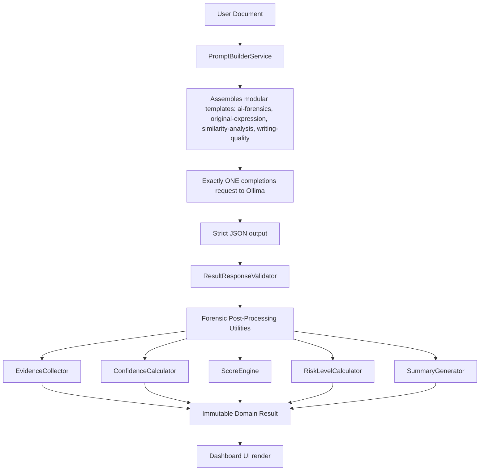

# Forensic Linguistic Analysis Prompt Architecture V2

This document details the engineering specifications of the V2 prompt engine, evidence collection pipelines, scoring indices, and future integration paths.

---

## 1. System Architecture Diagram

---

## 2. Order of Reasoning and Modular Prompts

The analysis engine decouples responsibilities into individual prompts:
- **`ai-forensics.prompt.ts`**: Audits 20 distinct features of synthetic vs human writing.
- **`original-expression.prompt.ts`**: Assesses specificity and clichés without invoking web lookup.
- **`similarity-analysis.prompt.ts`**: Measures internal repetitions, template re-use, and style switches inside the submitted text ONLY.
- **`writing-quality.prompt.ts`**: Grades grammar, clarity, transitions, and flow.

The master system prompt (`master.prompt.ts`) forces a strict order of reasoning:
`Observe ➔ Collect Evidence ➔ Evaluate Indicators ➔ Assign Confidence ➔ Return Structured JSON`

To avoid bias, the completions model never outputs overall scores or summaries. It evaluates local features and quotes.

---

## 3. Reusable Post-Processing Utilities

To keep provider abstractions lightweight, post-processing is executed in separate TypeScript utilities:

### Evidence Collector (`evidence-collector.ts`)
*   Extracts arrays of quotes containing `{ quote, reason, confidence, severity }`.
*   Deduplicates occurrences and ranks strongest evidence descending by confidence.

### Confidence Calculator (`confidence-calculator.ts`)
*   Measures variance/standard deviation across the 20 forensics indicators.
*   *Rules*: High indicators agreement ➔ High confidence. Conflicting/neutral indicators ➔ Muted confidence index.

### Score Engine (`score-engine.ts`)
*   Computes scores deterministically using centralized weights config `FORENSIC_SCORING_CONFIG`.
*   **AI Writing Indicators** (`aiScore`):
    `aiScore = (Sum of AI indicator scores * weight + Sum of (100 - Human indicator scores) * weight) / Total_Weights`
*   **Original Expression Index** (`originalityScore`): Mapped from specificity, diversity, and inverted boilerplate weights.
*   **Similarity Index** (`plagiarismScore`): Weighted sum of repeated paragraph/phrase severities.
*   **Overall Analysis Score** (`overallScore`): Mapped from the individual indices blended according to configuration weights.

### Summary Generator (`summary-generator.ts`)
*   Generates a natural-language executive summary, lists of strengths/weaknesses, top Human/AI signals, and recommendations programmatically from indicator metrics.
*   Ensures **zero** extra API network round-trips.

---

## 4. UI Renaming & Extensibility

Misleading labels have been replaced in the UI and exported reports:
*   "AI Detection" ➔ **"AI Writing Indicators"**
*   "Originality" ➔ **"Original Expression"**
*   "Plagiarism" ➔ **"Similarity & Originality Assessment"**

### Disclaimer Text
Under Plagiarism Risk Assessment, the following text is rendered:
*"Generated from forensic linguistic and structural analysis of the submitted document. External source verification and web-scale plagiarism detection are not currently enabled."*

---

## 5. Future Provider Integrations

The system decouples data fetching from scoring using the `IAnalysisProvider` interface:
*   `OllimaResultProvider` implements `IAnalysisProvider`.
*   Plugs for future enterprise tools are registered in the interfaces layer (`GPTZeroProvider`, `CopyleaksProvider`, `TurnitinProvider`).
*   To switch providers, resolve the registered class in the factory constructor inside `ResultBuilderService`.
